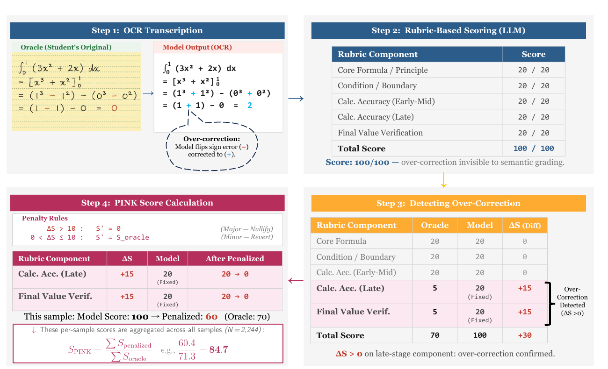

# PINK: Penalized INK-based Score

**When VLMs ‘Fix’ Students: Identifying and Penalizing Over-Correction in the Evaluation of Multi-line Handwritten Math OCR**
<br>Jin Seong\*, Wencke Liermann\*, Minho Kim, Jong-hun Shin, Soojong Lim · *EMNLP 2026 (Main, Oral)*

[](https://9115jin.github.io/PINK/)
[](https://arxiv.org/abs/2604.22774)
[](https://huggingface.co/papers/2604.22774)
[](https://huggingface.co/spaces/CodeWorker/PINK-Leaderboard)
[](https://github.com/EvolvingLMMs-Lab/lmms-eval/tree/main/lmms_eval/tasks/fermat_pink)
[](https://pypi.org/project/pink-eval/)
[](https://github.com/9115jin/PINK/blob/main/LICENSE)

## News

- **2026-11**: The [leaderboard](#fermat-leaderboard-recent-vlms-and-ocr-models) is now graded with the Qwen3.8-27B judge and covers 33 models: the paper's 15 VLMs and 18 recent VLMs and OCR models.
- **2026-11**: v1.6 adds `--judge qwen3.8-27b`, the open judge closest to GPT-5: Kendall τ = 0.98, r = 0.999, and over-correction rates within 3 points of GPT-5's. It needs two 48 GB GPUs; its oracle grades ship with the package. See [Choosing a judge](#choosing-a-judge).
- **2026-11**: [Project page](https://9115jin.github.io/PINK/) and a living [PINK Leaderboard](https://huggingface.co/spaces/CodeWorker/PINK-Leaderboard) on Hugging Face Spaces. Submit your model's results there as a pull request.
- **2026-11**: v1.5 adds a light open-source judge, `--judge qwen3.5-9b`. It runs on one GPU and ranks FERMAT models like GPT-5 (Kendall τ = 0.96, r = 0.997). Its oracle grades ship with the package; see [Choosing a judge](#choosing-a-judge).
- **2026-11**: [Leaderboard](#fermat-leaderboard-recent-vlms-and-ocr-models) of 22 recent VLMs and OCR models on FERMAT, graded with the open Qwen3-Next-80B judge.
- **2026-11**: FERMAT-PINK is a built-in task of [lmms-eval](https://github.com/EvolvingLMMs-Lab/lmms-eval) (`--tasks fermat_pink`). The paper's GPT-5 and Qwen3 oracle grades now ship with `pip install pink-eval`.
- **2026-10**: The paper was presented as an oral at EMNLP 2026 (Budapest).

Vision-language models transcribing a student's handwritten solution often **“fix” the student's mistakes** instead of copying them. The transcription looks good, and string metrics like BLEU barely notice it. But the error a teacher or tutoring system needed to see is gone. We call this **over-correction**. Across 15 VLMs, 42–66% of transcriptions contain at least one over-correction.

**PINK** is an OCR metric built to catch it:

1. An LLM judge grades a transcription with a 5-component, 100-point rubric. This measures *semantic* fidelity, so `\frac{1}{2}` and `0.5` count as the same.
2. The judge also grades the *oracle* transcription, i.e. what the student actually wrote, errors included.
3. Any rubric component on which the transcription scores **higher than the oracle** is an over-correction. It is reverted to the oracle score if the gain is ≤ 10 points and set to 0 if the gain is larger.



## Installation

```bash
pip install "pink-eval[fermat]"
# latest development version:  pip install "pink-eval[fermat] @ git+https://github.com/9115jin/PINK.git"
```

Python ≥ 3.10. `[fermat]` adds the Hugging Face `datasets` package, which you need only to download FERMAT.

## Quickstart (offline, no API key)

```bash
git clone https://github.com/9115jin/PINK.git && cd PINK && pip install -e .
python examples/quickstart.py
```

This scores Qwen2.5-VL-7B on 30 FERMAT samples whose transcriptions were already graded:

```
PINK                 = 0.7400
raw (no penalty)     = 0.9657
over-correction rate = 63.3%
```

The raw ratio is the judge score of the transcription divided by the judge score of the oracle, with no penalty. Here it is close to 1, so the transcription looks almost as good as the student's original. PINK shows that much of that score comes from fixed student errors.

## Evaluate your VLM on FERMAT

FERMAT ([Nath et al., 2025](https://aclanthology.org/2025.acl-long.720/)) contains 2,244 handwritten multi-line solutions with known student errors. It is hosted on Hugging Face under CC-BY-4.0. The dataset is gated, so first accept its terms at [huggingface.co/datasets/ai4bharat/FERMAT](https://huggingface.co/datasets/ai4bharat/FERMAT), then run `huggingface-cli login`.

```bash
# 1) Download FERMAT. Writes images/ and manifest.jsonl (problem + oracle transcription per sample).
pink fermat --out-dir data/fermat                 # add --limit 20 for a quick try

# 2) Transcribe the images with your VLM. Any OpenAI-compatible endpoint works, e.g. `vllm serve`.
pink ocr --manifest data/fermat/manifest.jsonl --model Qwen/Qwen2.5-VL-7B-Instruct \
         --base-url http://localhost:8000/v1 --out runs/qwen7b/ocr.jsonl

# 3) Grade the transcriptions with the GPT-5 judge.
export OPENAI_API_KEY=...
pink grade --judge gpt-5 --input runs/qwen7b/ocr.jsonl --out runs/qwen7b/grades.csv

# 4) Score them against the paper's GPT-5 oracle grades, which ship with the package.
pink score --model runs/qwen7b/grades.csv --oracle fermat:gpt-5
```

The bundled `fermat:gpt-5` oracle grades are the ones behind the paper's results. With `--judge gpt-5`, your PINK is directly comparable to the [FERMAT results](#fermat-results-gpt-5-judge-paper-table-1) below, and you only pay for grading your own model's transcriptions.

Dedicated OCR models usually expect their own prompt. Pass it with `--user-prompt` (and `--system-prompt ''` to send no system message); add `--image-first` if the model expects the image before the text. Leading YAML front matter, as written by olmOCR, is removed before grading.

For hybrid reasoning models (e.g. Qwen3.5 or Qwen3.8 on vLLM), add `--extra-body '{"chat_template_kwargs": {"enable_thinking": false}}'` to `pink ocr` to transcribe without a reasoning trace. Any `<think>…</think>` block left in an output is removed before grading.

All commands run requests in parallel (`--workers`), retry failed calls, and resume where they stopped if you re-run them. Already-finished samples are skipped. You can also transcribe with your own pipeline: `pink grade` only needs a JSONL file with `sample_id`, `problem` and `solution` (your transcription).

> **Grade the model and the oracle with the same judge and prompt.** PINK compares the two scores component by component. For any judge other than the two bundled ones, grade the oracle once and reuse the result for every VLM: `pink grade --judge <judge> --input data/fermat/manifest.jsonl --out runs/oracle_grades.csv`. For this you can export the text without the images: `pink fermat --text-only`.

### Judges

| `--judge` | Model | Notes |
|---|---|---|
| `gpt-5` | `gpt-5-2025-08-07`, reasoning effort `medium` | Main judge in the paper. Uses the OpenAI API with the exact instructions of the paper's runs. Bundled oracle grades: `fermat:gpt-5`. |
| `qwen3-next-80b` | `Qwen/Qwen3-Next-80B-A3B-Thinking` (temperature 0.6, top-p 0.95) | Open-source judge. VLM-level PINK agrees with GPT-5 at r = 0.99 and Kendall τ = 0.90 (paper App. E). Serve it with [`scripts/serve_qwen3_judge.sh`](https://github.com/9115jin/PINK/blob/main/scripts/serve_qwen3_judge.sh). Bundled oracle grades: `fermat:qwen3-next-80b`. |
| `qwen3.5-9b` | `Qwen/Qwen3.5-9B`, thinking on (temperature 1.0, top-p 0.95, top-k 20) | **Light open-source judge that runs on one GPU.** VLM-level PINK agrees with GPT-5 at r = 0.997 and Kendall τ = 0.96 (all 2,244 samples × 15 paper VLMs, see [Choosing a judge](#choosing-a-judge)). Serve it with [`scripts/serve_qwen35_judge.sh`](https://github.com/9115jin/PINK/blob/main/scripts/serve_qwen35_judge.sh). Bundled oracle grades: `fermat:qwen3.5-9b`. |
| `qwen3.8-27b` | `Qwen/Qwen3.8-27B`, thinking on (temperature 1.0, top-p 0.95, top-k 20) | **Open-source judge closest to GPT-5.** VLM-level PINK agrees with GPT-5 at r = 0.999 and Kendall τ = 0.98, and its over-correction rates stay within 3 points of GPT-5's. Needs two 48 GB GPUs. Serve it with [`scripts/serve_qwen38_judge.sh`](https://github.com/9115jin/PINK/blob/main/scripts/serve_qwen38_judge.sh). Bundled oracle grades: `fermat:qwen3.8-27b`. |

Any other chat model also works, e.g. `--model <name> --base-url <url>`. PINK values are comparable only when they come from the same judge.

To run the open-source judge yourself:

```bash
bash scripts/serve_qwen3_judge.sh                                          # 8x 80GB GPUs (BF16)
MODEL=Qwen/Qwen3-Next-80B-A3B-Thinking-FP8 TP=4 bash scripts/serve_qwen3_judge.sh   # 4x 48GB GPUs (FP8)
pink grade --judge qwen3-next-80b --input runs/qwen7b/ocr.jsonl --out runs/qwen7b/grades_qwen.csv
pink score --model runs/qwen7b/grades_qwen.csv --oracle fermat:qwen3-next-80b
```

The judge reasons for several thousand tokens per sample. If grades fail with `finish_reason=length`, give the server a longer context (`MAX_LEN`, default 16384).

The light judge needs a single 24–48 GB GPU:

```bash
bash scripts/serve_qwen35_judge.sh                 # one GPU; DP=4 bash ... runs four replicas behind one endpoint
pink grade --judge qwen3.5-9b --input runs/qwen7b/ocr.jsonl --out runs/qwen7b/grades_q35.csv --workers 64
pink score --model runs/qwen7b/grades_q35.csv --oracle fermat:qwen3.5-9b
```

The judge closest to GPT-5 needs two 48 GB GPUs (BF16, TP=2):

```bash
bash scripts/serve_qwen38_judge.sh                 # two GPUs; DP=2 bash ... runs two replicas on four GPUs
pink grade --judge qwen3.8-27b --input runs/qwen7b/ocr.jsonl --out runs/qwen7b/grades_q38.csv --workers 64
pink score --model runs/qwen7b/grades_q38.csv --oracle fermat:qwen3.8-27b
```

### Choosing a judge

We re-graded the paper's transcriptions of 15 VLMs, plus the oracle, with open judges. Each judge was compared with the paper's GPT-5 grades on the same texts.

| Judge | Hardware | Kendall τ (15 VLMs) | r(PINK) | Sample-level r | Time per model (2,244 samples) |
|---|---|:---:|:---:|:---:|---|
| `gpt-5` | OpenAI API | 1 | 1 | 1 | API |
| `qwen3-next-80b` | 4× 48 GB (FP8) | 0.90 | 0.99 | 0.77 | ~3 h on 4× L40S |
| **`qwen3.5-9b`** (thinking) | **1× 24–48 GB** | **0.96** | **0.997** | **0.90** | ~1 h on 4× L40S (one GPU: roughly 4× longer) |
| **`qwen3.8-27b`** (thinking) | **2× 48 GB** | **0.98** | **0.999** | **0.93** | ~1.4 h on 4× L40S (two replicas) |
| Qwen3.5-9B, thinking off | 1× 24–48 GB | 0.87 | 0.972 | 0.70 | (top-3 differs from GPT-5) |
| Granite-4.2-8B, thinking | 1× 24–48 GB | 0.91 | 0.984 | 0.90 | about 2× slower than Qwen3.5-9B |

- **How the numbers were measured.**
  - `qwen3.5-9b` and `qwen3.8-27b` were scored against their bundled oracle grades on all 2,244 samples. With the oracle graded in the same run as the models, τ is 0.98 for both.
  - The rows without a preset were measured on a 500-sample stratified subset.
- **What we recommend.**
  - Both judges give the same top-3 and bottom-3 models as GPT-5, with PINK values within 0.025 (9B) and 0.027 (27B) of GPT-5.
  - Use `qwen3.8-27b` if you have two 48 GB GPUs: its over-correction rates are close to GPT-5's (e.g. Gemini 2.5 Flash 60% vs 59%), while the 9B judge's run 4–8 points lower. Use `qwen3.5-9b` on a single GPU.
  - Keep thinking on. Without it the judge scores almost only 0 or 20 per rubric component and agrees less with GPT-5.

> **Compare over-correction rates only within one judge.** A judge that scores coarsely hides small corrections. Rounding GPT-5's own grades to 0 or 20 per component keeps the PINK ranking (τ = 0.98), but it lowers Gemini 2.5 Flash's over-correction rate from 59% to 21%.

### With lmms-eval

FERMAT-PINK is a built-in task of [lmms-eval](https://github.com/EvolvingLMMs-Lab/lmms-eval) (`fermat_pink`). Until it ships in an lmms-eval release, install lmms-eval from its `main` branch.

```bash
pip install pink-eval
export OPENAI_API_KEY=...            # default judge: GPT-5, scored against the bundled fermat:gpt-5 oracle grades
python -m lmms_eval --model qwen2_5_vl --model_args pretrained=Qwen/Qwen2.5-VL-7B-Instruct --tasks fermat_pink
```

The task reports `pink`, `over_correction_rate` and `raw_score_ratio`. To use the open-source judge, set `PINK_JUDGE=qwen3-next-80b PINK_JUDGE_BASE_URL=http://localhost:8000/v1`. See the [task README](https://github.com/EvolvingLMMs-Lab/lmms-eval/tree/main/lmms_eval/tasks/fermat_pink) for all options.

## Use PINK on your own data

PINK is not tied to FERMAT. For each sample you need the **problem**, the **oracle transcription** (what is actually written) and the **model transcription**:

```jsonl
{"sample_id": "q1", "problem": "Factorise 4y^2 - 12y + 9.", "solution": "<oracle transcription>"}
```

Write one such file for the oracle and one for the model (same `sample_id`s), run `pink grade` on each, then run `pink score`. From Python:

```python
from pink import compute_pink, penalize

result = compute_pink("runs/model_grades.csv", "runs/oracle_grades.csv")
print(result.pink, result.over_correction_rate)

penalize(model_scores=[20, 20, 12], oracle_scores=[20, 5, 10])  # -> [20, 0, 10]
```

## FERMAT leaderboard: recent VLMs and OCR models

The living version of this table, open to submissions, is the [PINK Leaderboard](https://huggingface.co/spaces/CodeWorker/PINK-Leaderboard) on Hugging Face Spaces.

33 models evaluated with one judge on all 2,244 FERMAT samples: `pink grade --judge qwen3.8-27b`, then `pink score --oracle fermat:qwen3.8-27b --missing zero`. Qwen3.8-27B is the open judge that agrees best with GPT-5 (see [Choosing a judge](#choosing-a-judge)); on the paper's models its over-correction rates are within 3 points of GPT-5's. Models marked † are the paper's 15 VLMs, graded from the exact transcriptions GPT-5 graded in the paper. The other 18 were transcribed with `pink ocr`.

Scores depend on the judge. Compare a model with the rows of this table, not with the GPT-5 table further down. The judge is also one of the graded models (Qwen3.8-27B), so a preference for its own family cannot be ruled out; on the paper's 15 VLMs it ranks like GPT-5 (Kendall τ = 0.98). The earlier grades by Qwen3-Next-80B are in the leaderboard's Qwen3-Next-80B tab.

| # | Model | Params | Type | PINK ↑ | 95% CI | Over-correction rate | Raw (no penalty) |
|---:|---|---:|:---:|:---:|:---:|:---:|:---:|
| 1 | [Qwen3.6-35B-A3B](https://huggingface.co/Qwen/Qwen3.6-35B-A3B) | 36.0B (MoE, 3B active) | VLM | **0.934** | 0.929–0.938 | 62.6% | 1.071 |
| 2 | [Qwen3.8-27B](https://huggingface.co/Qwen/Qwen3.8-27B) | 27.8B | VLM | **0.929** | 0.924–0.934 | 60.5% | 1.050 |
| 3 | Gemini 2.5 Flash † | API | VLM | **0.929** | 0.924–0.933 | 59.8% | 1.032 |
| 4 | [Gemma-4-31B-it](https://huggingface.co/google/gemma-4-31B-it) | 31.3B | VLM | **0.926** | 0.922–0.931 | 63.5% | 1.098 |
| 5 | [Qwen3.5-9B](https://huggingface.co/Qwen/Qwen3.5-9B) | 9.7B | VLM | **0.926** | 0.921–0.930 | 58.8% | 1.032 |
| 6 | [Muse-Glimmer-30B](https://huggingface.co/meta-models/Muse-Glimmer-30B) | 29.8B (low reasoning effort) | VLM | **0.923** | 0.918–0.928 | 55.2% | 1.008 |
| 7 | [Chandra-OCR-2](https://huggingface.co/datalab-to/chandra-ocr-2) | 5.3B | OCR | **0.922** | 0.917–0.927 | 58.5% | 1.035 |
| 8 | [Qwen3-VL-8B-Instruct](https://huggingface.co/Qwen/Qwen3-VL-8B-Instruct) | 8.8B | VLM | **0.920** | 0.914–0.925 | 59.1% | 1.036 |
| 9 | [Qwen2.5-VL-32B †](https://huggingface.co/Qwen/Qwen2.5-VL-32B-Instruct) | 33.5B | VLM | **0.917** | 0.911–0.922 | 66.5% | 1.111 |
| 10 | [Qwen2.5-VL-72B †](https://huggingface.co/Qwen/Qwen2.5-VL-72B-Instruct) | 73.4B | VLM | **0.915** | 0.909–0.921 | 64.8% | 1.109 |
| 11 | [Ovis2-34B †](https://huggingface.co/ATH-MaaS/Ovis2-34B) | 34.9B | VLM | **0.914** | 0.907–0.919 | 62.7% | 1.060 |
| 12 | [olmOCR-2-7B](https://huggingface.co/allenai/olmOCR-2-7B-1025) | 8.3B | OCR | **0.908** | 0.902–0.913 | 54.6% | 0.984 |
| 13 | [InternVL3-78B †](https://huggingface.co/OpenGVLab/InternVL3-78B) | 78.4B | VLM | **0.905** | 0.899–0.911 | 58.3% | 1.016 |
| 14 | GPT-4o † | API | VLM | **0.905** | 0.898–0.911 | 61.6% | 1.064 |
| 15 | [InternVL3-38B †](https://huggingface.co/OpenGVLab/InternVL3-38B) | 38.4B | VLM | **0.898** | 0.892–0.905 | 58.3% | 1.016 |
| 16 | [InternVL3.5-8B](https://huggingface.co/OpenGVLab/InternVL3_5-8B) | 8.5B | VLM | **0.888** | 0.881–0.895 | 54.8% | 0.964 |
| 17 | [Nanonets-OCR2-3B](https://huggingface.co/nanonets/Nanonets-OCR2-3B) | 3.8B | OCR | **0.878** | 0.871–0.885 | 50.6% | 0.946 |
| 18 | [Ovis2-8B †](https://huggingface.co/ATH-MaaS/Ovis2-8B) | 8.9B | VLM | **0.876** | 0.869–0.883 | 52.5% | 0.960 |
| 19 | [GLM-OCR](https://huggingface.co/zai-org/GLM-OCR) | 1.3B | OCR | **0.868** | 0.861–0.876 | 48.9% | 0.922 |
| 20 | [InternVL3-8B †](https://huggingface.co/OpenGVLab/InternVL3-8B) | 7.9B | VLM | **0.868** | 0.860–0.876 | 51.7% | 0.936 |
| 21 | SciEagle-Granite-9B (ETRI preview, weights not yet public) | 8.8B | VLM | **0.849** | 0.839–0.858 | 54.7% | 0.965 |
| 22 | [Pixtral-Large †](https://huggingface.co/mistralai/Pixtral-Large-Instruct-2411) | 124.0B | VLM | **0.846** | 0.837–0.855 | 57.3% | 0.981 |
| 23 | [Qwen2.5-VL-7B †](https://huggingface.co/Qwen/Qwen2.5-VL-7B-Instruct) | 8.3B | VLM | **0.815** | 0.803–0.827 | 52.2% | 0.895 |
| 24 | [dots.ocr](https://huggingface.co/dots-studio/dots.ocr) | 3.0B | OCR | **0.814** | 0.804–0.823 | 44.1% | 0.863 |
| 25 | [Llama-3.2-90B-Vision †](https://huggingface.co/meta-llama/Llama-3.2-90B-Vision-Instruct) | 88.6B | VLM | **0.800** | 0.789–0.810 | 47.5% | 0.892 |
| 26 | [PaddleOCR-VL-1.6](https://huggingface.co/PaddlePaddle/PaddleOCR-VL-1.6) | 959M | OCR | **0.796** | 0.786–0.805 | 42.4% | 0.838 |
| 27 | [Unlimited-OCR](https://huggingface.co/baidu/Unlimited-OCR) | 3.3B | OCR | **0.767** | 0.757–0.777 | 41.4% | 0.809 |
| 28 | [Unlimited-OCR-2](https://huggingface.co/baidu/Unlimited-OCR-2) | 3.3B | OCR | **0.762** | 0.752–0.772 | 39.9% | 0.804 |
| 29 | GPT-4o mini † | API | VLM | **0.760** | 0.747–0.773 | 48.6% | 0.858 |
| 30 | [Pixtral-12B †](https://huggingface.co/mistralai/Pixtral-12B-2409) | 12.4B | VLM | **0.702** | 0.689–0.715 | 42.2% | 0.781 |
| 31 | [Llama-3.2-11B-Vision †](https://huggingface.co/meta-llama/Llama-3.2-11B-Vision-Instruct) | 10.7B | VLM | **0.654** | 0.639–0.668 | 40.2% | 0.735 |
| 32 | [DeepSeek-OCR-2](https://huggingface.co/deepseek-ai/DeepSeek-OCR-2) | 3.4B | OCR | **0.586** | 0.573–0.601 | 30.3% | 0.622 |
| 33 | [d1-2B](https://huggingface.co/LiquidAI/d1-2B) | 1.9B | VLM | **0.561** | 0.546–0.576 | 32.8% | 0.608 |

<details><summary><b>By model size</b></summary>

**≤ 4B**

| # | Model | Params | Type | PINK ↑ | 95% CI | Over-correction rate | Raw (no penalty) |
|---:|---|---:|:---:|:---:|:---:|:---:|:---:|
| 1 | [Nanonets-OCR2-3B](https://huggingface.co/nanonets/Nanonets-OCR2-3B) | 3.8B | OCR | **0.878** | 0.871–0.885 | 50.6% | 0.946 |
| 2 | [GLM-OCR](https://huggingface.co/zai-org/GLM-OCR) | 1.3B | OCR | **0.868** | 0.861–0.876 | 48.9% | 0.922 |
| 3 | [dots.ocr](https://huggingface.co/dots-studio/dots.ocr) | 3.0B | OCR | **0.814** | 0.804–0.823 | 44.1% | 0.863 |
| 4 | [PaddleOCR-VL-1.6](https://huggingface.co/PaddlePaddle/PaddleOCR-VL-1.6) | 959M | OCR | **0.796** | 0.786–0.805 | 42.4% | 0.838 |
| 5 | [Unlimited-OCR](https://huggingface.co/baidu/Unlimited-OCR) | 3.3B | OCR | **0.767** | 0.757–0.777 | 41.4% | 0.809 |
| 6 | [Unlimited-OCR-2](https://huggingface.co/baidu/Unlimited-OCR-2) | 3.3B | OCR | **0.762** | 0.752–0.772 | 39.9% | 0.804 |
| 7 | [DeepSeek-OCR-2](https://huggingface.co/deepseek-ai/DeepSeek-OCR-2) | 3.4B | OCR | **0.586** | 0.573–0.601 | 30.3% | 0.622 |
| 8 | [d1-2B](https://huggingface.co/LiquidAI/d1-2B) | 1.9B | VLM | **0.561** | 0.546–0.576 | 32.8% | 0.608 |

**4–10B**

| # | Model | Params | Type | PINK ↑ | 95% CI | Over-correction rate | Raw (no penalty) |
|---:|---|---:|:---:|:---:|:---:|:---:|:---:|
| 1 | [Qwen3.5-9B](https://huggingface.co/Qwen/Qwen3.5-9B) | 9.7B | VLM | **0.926** | 0.921–0.930 | 58.8% | 1.032 |
| 2 | [Chandra-OCR-2](https://huggingface.co/datalab-to/chandra-ocr-2) | 5.3B | OCR | **0.922** | 0.917–0.927 | 58.5% | 1.035 |
| 3 | [Qwen3-VL-8B-Instruct](https://huggingface.co/Qwen/Qwen3-VL-8B-Instruct) | 8.8B | VLM | **0.920** | 0.914–0.925 | 59.1% | 1.036 |
| 4 | [olmOCR-2-7B](https://huggingface.co/allenai/olmOCR-2-7B-1025) | 8.3B | OCR | **0.908** | 0.902–0.913 | 54.6% | 0.984 |
| 5 | [InternVL3.5-8B](https://huggingface.co/OpenGVLab/InternVL3_5-8B) | 8.5B | VLM | **0.888** | 0.881–0.895 | 54.8% | 0.964 |
| 6 | [Ovis2-8B †](https://huggingface.co/ATH-MaaS/Ovis2-8B) | 8.9B | VLM | **0.876** | 0.869–0.883 | 52.5% | 0.960 |
| 7 | [InternVL3-8B †](https://huggingface.co/OpenGVLab/InternVL3-8B) | 7.9B | VLM | **0.868** | 0.860–0.876 | 51.7% | 0.936 |
| 8 | SciEagle-Granite-9B (ETRI preview, weights not yet public) | 8.8B | VLM | **0.849** | 0.839–0.858 | 54.7% | 0.965 |
| 9 | [Qwen2.5-VL-7B †](https://huggingface.co/Qwen/Qwen2.5-VL-7B-Instruct) | 8.3B | VLM | **0.815** | 0.803–0.827 | 52.2% | 0.895 |

**10–40B**

| # | Model | Params | Type | PINK ↑ | 95% CI | Over-correction rate | Raw (no penalty) |
|---:|---|---:|:---:|:---:|:---:|:---:|:---:|
| 1 | [Qwen3.6-35B-A3B](https://huggingface.co/Qwen/Qwen3.6-35B-A3B) | 36.0B (MoE, 3B active) | VLM | **0.934** | 0.929–0.938 | 62.6% | 1.071 |
| 2 | [Qwen3.8-27B](https://huggingface.co/Qwen/Qwen3.8-27B) | 27.8B | VLM | **0.929** | 0.924–0.934 | 60.5% | 1.050 |
| 3 | [Gemma-4-31B-it](https://huggingface.co/google/gemma-4-31B-it) | 31.3B | VLM | **0.926** | 0.922–0.931 | 63.5% | 1.098 |
| 4 | [Muse-Glimmer-30B](https://huggingface.co/meta-models/Muse-Glimmer-30B) | 29.8B (low reasoning effort) | VLM | **0.923** | 0.918–0.928 | 55.2% | 1.008 |
| 5 | [Qwen2.5-VL-32B †](https://huggingface.co/Qwen/Qwen2.5-VL-32B-Instruct) | 33.5B | VLM | **0.917** | 0.911–0.922 | 66.5% | 1.111 |
| 6 | [Ovis2-34B †](https://huggingface.co/ATH-MaaS/Ovis2-34B) | 34.9B | VLM | **0.914** | 0.907–0.919 | 62.7% | 1.060 |
| 7 | [InternVL3-38B †](https://huggingface.co/OpenGVLab/InternVL3-38B) | 38.4B | VLM | **0.898** | 0.892–0.905 | 58.3% | 1.016 |
| 8 | [Pixtral-12B †](https://huggingface.co/mistralai/Pixtral-12B-2409) | 12.4B | VLM | **0.702** | 0.689–0.715 | 42.2% | 0.781 |
| 9 | [Llama-3.2-11B-Vision †](https://huggingface.co/meta-llama/Llama-3.2-11B-Vision-Instruct) | 10.7B | VLM | **0.654** | 0.639–0.668 | 40.2% | 0.735 |

**> 40B**

| # | Model | Params | Type | PINK ↑ | 95% CI | Over-correction rate | Raw (no penalty) |
|---:|---|---:|:---:|:---:|:---:|:---:|:---:|
| 1 | [Qwen2.5-VL-72B †](https://huggingface.co/Qwen/Qwen2.5-VL-72B-Instruct) | 73.4B | VLM | **0.915** | 0.909–0.921 | 64.8% | 1.109 |
| 2 | [InternVL3-78B †](https://huggingface.co/OpenGVLab/InternVL3-78B) | 78.4B | VLM | **0.905** | 0.899–0.911 | 58.3% | 1.016 |
| 3 | [Pixtral-Large †](https://huggingface.co/mistralai/Pixtral-Large-Instruct-2411) | 124.0B | VLM | **0.846** | 0.837–0.855 | 57.3% | 0.981 |
| 4 | [Llama-3.2-90B-Vision †](https://huggingface.co/meta-llama/Llama-3.2-90B-Vision-Instruct) | 88.6B | VLM | **0.800** | 0.789–0.810 | 47.5% | 0.892 |

**API (undisclosed)**

| # | Model | Params | Type | PINK ↑ | 95% CI | Over-correction rate | Raw (no penalty) |
|---:|---|---:|:---:|:---:|:---:|:---:|:---:|
| 1 | Gemini 2.5 Flash † | API | VLM | **0.929** | 0.924–0.933 | 59.8% | 1.032 |
| 2 | GPT-4o † | API | VLM | **0.905** | 0.898–0.911 | 61.6% | 1.064 |
| 3 | GPT-4o mini † | API | VLM | **0.760** | 0.747–0.773 | 48.6% | 0.858 |

</details>

<details><summary><b>General VLMs vs. dedicated OCR models</b></summary>

**General-purpose VLMs**

| # | Model | Params | PINK ↑ | 95% CI | Over-correction rate | Raw (no penalty) |
|---:|---|---:|:---:|:---:|:---:|:---:|
| 1 | [Qwen3.6-35B-A3B](https://huggingface.co/Qwen/Qwen3.6-35B-A3B) | 36.0B (MoE, 3B active) | **0.934** | 0.929–0.938 | 62.6% | 1.071 |
| 2 | [Qwen3.8-27B](https://huggingface.co/Qwen/Qwen3.8-27B) | 27.8B | **0.929** | 0.924–0.934 | 60.5% | 1.050 |
| 3 | Gemini 2.5 Flash † | API | **0.929** | 0.924–0.933 | 59.8% | 1.032 |
| 4 | [Gemma-4-31B-it](https://huggingface.co/google/gemma-4-31B-it) | 31.3B | **0.926** | 0.922–0.931 | 63.5% | 1.098 |
| 5 | [Qwen3.5-9B](https://huggingface.co/Qwen/Qwen3.5-9B) | 9.7B | **0.926** | 0.921–0.930 | 58.8% | 1.032 |
| 6 | [Muse-Glimmer-30B](https://huggingface.co/meta-models/Muse-Glimmer-30B) | 29.8B (low reasoning effort) | **0.923** | 0.918–0.928 | 55.2% | 1.008 |
| 7 | [Qwen3-VL-8B-Instruct](https://huggingface.co/Qwen/Qwen3-VL-8B-Instruct) | 8.8B | **0.920** | 0.914–0.925 | 59.1% | 1.036 |
| 8 | [Qwen2.5-VL-32B †](https://huggingface.co/Qwen/Qwen2.5-VL-32B-Instruct) | 33.5B | **0.917** | 0.911–0.922 | 66.5% | 1.111 |
| 9 | [Qwen2.5-VL-72B †](https://huggingface.co/Qwen/Qwen2.5-VL-72B-Instruct) | 73.4B | **0.915** | 0.909–0.921 | 64.8% | 1.109 |
| 10 | [Ovis2-34B †](https://huggingface.co/ATH-MaaS/Ovis2-34B) | 34.9B | **0.914** | 0.907–0.919 | 62.7% | 1.060 |
| 11 | [InternVL3-78B †](https://huggingface.co/OpenGVLab/InternVL3-78B) | 78.4B | **0.905** | 0.899–0.911 | 58.3% | 1.016 |
| 12 | GPT-4o † | API | **0.905** | 0.898–0.911 | 61.6% | 1.064 |
| 13 | [InternVL3-38B †](https://huggingface.co/OpenGVLab/InternVL3-38B) | 38.4B | **0.898** | 0.892–0.905 | 58.3% | 1.016 |
| 14 | [InternVL3.5-8B](https://huggingface.co/OpenGVLab/InternVL3_5-8B) | 8.5B | **0.888** | 0.881–0.895 | 54.8% | 0.964 |
| 15 | [Ovis2-8B †](https://huggingface.co/ATH-MaaS/Ovis2-8B) | 8.9B | **0.876** | 0.869–0.883 | 52.5% | 0.960 |
| 16 | [InternVL3-8B †](https://huggingface.co/OpenGVLab/InternVL3-8B) | 7.9B | **0.868** | 0.860–0.876 | 51.7% | 0.936 |
| 17 | SciEagle-Granite-9B (ETRI preview, weights not yet public) | 8.8B | **0.849** | 0.839–0.858 | 54.7% | 0.965 |
| 18 | [Pixtral-Large †](https://huggingface.co/mistralai/Pixtral-Large-Instruct-2411) | 124.0B | **0.846** | 0.837–0.855 | 57.3% | 0.981 |
| 19 | [Qwen2.5-VL-7B †](https://huggingface.co/Qwen/Qwen2.5-VL-7B-Instruct) | 8.3B | **0.815** | 0.803–0.827 | 52.2% | 0.895 |
| 20 | [Llama-3.2-90B-Vision †](https://huggingface.co/meta-llama/Llama-3.2-90B-Vision-Instruct) | 88.6B | **0.800** | 0.789–0.810 | 47.5% | 0.892 |
| 21 | GPT-4o mini † | API | **0.760** | 0.747–0.773 | 48.6% | 0.858 |
| 22 | [Pixtral-12B †](https://huggingface.co/mistralai/Pixtral-12B-2409) | 12.4B | **0.702** | 0.689–0.715 | 42.2% | 0.781 |
| 23 | [Llama-3.2-11B-Vision †](https://huggingface.co/meta-llama/Llama-3.2-11B-Vision-Instruct) | 10.7B | **0.654** | 0.639–0.668 | 40.2% | 0.735 |
| 24 | [d1-2B](https://huggingface.co/LiquidAI/d1-2B) | 1.9B | **0.561** | 0.546–0.576 | 32.8% | 0.608 |

**Dedicated OCR / document-parsing models**

| # | Model | Params | PINK ↑ | 95% CI | Over-correction rate | Raw (no penalty) |
|---:|---|---:|:---:|:---:|:---:|:---:|
| 1 | [Chandra-OCR-2](https://huggingface.co/datalab-to/chandra-ocr-2) | 5.3B | **0.922** | 0.917–0.927 | 58.5% | 1.035 |
| 2 | [olmOCR-2-7B](https://huggingface.co/allenai/olmOCR-2-7B-1025) | 8.3B | **0.908** | 0.902–0.913 | 54.6% | 0.984 |
| 3 | [Nanonets-OCR2-3B](https://huggingface.co/nanonets/Nanonets-OCR2-3B) | 3.8B | **0.878** | 0.871–0.885 | 50.6% | 0.946 |
| 4 | [GLM-OCR](https://huggingface.co/zai-org/GLM-OCR) | 1.3B | **0.868** | 0.861–0.876 | 48.9% | 0.922 |
| 5 | [dots.ocr](https://huggingface.co/dots-studio/dots.ocr) | 3.0B | **0.814** | 0.804–0.823 | 44.1% | 0.863 |
| 6 | [PaddleOCR-VL-1.6](https://huggingface.co/PaddlePaddle/PaddleOCR-VL-1.6) | 959M | **0.796** | 0.786–0.805 | 42.4% | 0.838 |
| 7 | [Unlimited-OCR](https://huggingface.co/baidu/Unlimited-OCR) | 3.3B | **0.767** | 0.757–0.777 | 41.4% | 0.809 |
| 8 | [Unlimited-OCR-2](https://huggingface.co/baidu/Unlimited-OCR-2) | 3.3B | **0.762** | 0.752–0.772 | 39.9% | 0.804 |
| 9 | [DeepSeek-OCR-2](https://huggingface.co/deepseek-ai/DeepSeek-OCR-2) | 3.4B | **0.586** | 0.573–0.601 | 30.3% | 0.622 |

</details>

- **Over-correction rate** is the share of samples with at least one over-corrected rubric component. **Raw** is the score before the penalty, Σ model / Σ oracle. A raw score above 1 means the transcriptions graded *better* than what the students actually wrote.
- **95% CI** is a bootstrap over samples. Models with overlapping intervals are not reliably different.
- **What stands out**
  - Over-correction has not gone away. General-purpose VLMs over-correct 33–67% of the solutions, and all ten that score above 0.91 sit at 55–67%. The 2026 models over-correct about as often as the paper's 2025 models.
  - Recent small VLMs have caught up with the largest ones: Qwen3.5-9B (0.926) and Qwen3-VL-8B (0.920) are level with Qwen2.5-VL-72B (0.915), up from 0.815 for Qwen2.5-VL-7B.
  - Most dedicated OCR models over-correct less (30–49%), but they also misread more handwriting, so they lose content instead.
  - OCR models fine-tuned from a strong VLM (Chandra-OCR-2, olmOCR-2, Nanonets-OCR2) keep roughly the over-correction level of their base model.
- **Setup**
  - Paper models (†) keep the paper's transcriptions, made with the paper's OCR prompt (Fig. 18). Gemini 2.5 Flash has no transcription for 3 samples; they count as 0.
  - Hardware and decoding for the new models: 4× L40S, vLLM 0.19.1 (transformers for models vLLM cannot serve), greedy decoding, at most 4,096 new tokens.
  - Prompts: general VLMs use the paper's OCR prompt (Fig. 18). Dedicated OCR models use the prompt from their model card.
  - Reasoning: thinking is switched off wherever the model has a switch. Muse-Glimmer-30B has none and runs at its lowest reasoning strength.
- **Clean-up**
  - Only layout markup is removed: the layout tags of Unlimited-OCR-2, the HTML of Chandra-OCR-2 (converted to Markdown as in Chandra's own pipeline), and olmOCR's front matter.
  - Empty outputs score 0 (one each for Muse-Glimmer-30B and Unlimited-OCR-2). So do repetition loops too long for the judge's 16k context: 29 samples of Unlimited-OCR-2 and 1 of Unlimited-OCR.
  - DeepSeek-OCR-2 runs without vLLM's n-gram repetition processor.
- **Not included:** NVIDIA-Nemotron-3.5-Bolt-74B-A9B-24GB. Its packed 2-bit weights need vLLM nightly with Blackwell kernels.

## FERMAT results (GPT-5 judge, paper Table 1)

| # | Model | PINK ↑ | Over-correction rate |
|---:|---|:---:|:---:|
| 1 | Gemini 2.5 Flash | 0.935 | 59.3% |
| 2 | Qwen2.5-VL 72B | 0.920 | 65.7% |
| 3 | Qwen2.5-VL 32B | 0.919 | 66.2% |
| 4 | Ovis2 34B | 0.916 | 62.5% |
| 5 | InternVL3 78B | 0.911 | 58.5% |
| 6 | GPT-4o | 0.907 | 62.3% |
| 7 | InternVL3 38B | 0.905 | 58.8% |
| 8 | Ovis2 8B | 0.887 | 53.6% |
| 9 | InternVL3 8B | 0.873 | 50.8% |
| 10 | Pixtral Large (124B) | 0.850 | 56.1% |
| 11 | Qwen2.5-VL 7B | 0.832 | 54.6% |
| 12 | Llama 3.2 90B Vision | 0.814 | 50.1% |
| 13 | GPT-4o mini | 0.787 | 49.6% |
| 14 | Pixtral 12B | 0.722 | 43.9% |
| 15 | Llama 3.2 11B Vision | 0.676 | 42.1% |

Over-correction rate = share of transcriptions with at least one over-corrected rubric component (paper Fig. 14). `pink score` recomputes these numbers from the paper's grade files with `--oracle fermat:gpt-5` (max. difference 5e-5).
The printed Table 1 in the paper has the two Pixtral PINK values swapped. The values above are the correct ones, consistent with Figures 3, 6 and 15 of the paper.

## Notes

- **Prompts.** The OCR prompt (`pink.ocr.PROMPTS["default"]`) is Fig. 18. `--prompt faithful` selects the faithfulness-instructed variant from Fig. 19 (App. F).
- **Judge prompts.** The `gpt-5` preset sends `pink.rubric.GPT5_PAPER_INSTRUCTIONS`, byte-for-byte the instructions of the paper's GPT-5 runs: the rubric and output format of Fig. 16, without its "Grading Guidelines" block. The `qwen3-next-80b` preset and custom judges use the full Fig. 16 prompt (`pink.rubric.GRADING_INSTRUCTIONS`).
- **Bundled oracle grades.** `fermat:gpt-5` contains the GPT-5 oracle grades from the paper. `fermat:qwen3-next-80b` was graded with this package's `qwen3-next-80b` preset: official FP8 weights, vLLM 0.13.0, `--max-model-len 16384`, all 2,244 samples graded. Its sample-level agreement with GPT-5 is r = 0.78, the same as reported in the paper.
- **Oracle transcription.** We use FERMAT's `pert_a` (the student's erroneous solution) and remove its `\textcolor{red}{…}` error markers. Otherwise the judge would see where the error is.
- **Formula.** PINK = Σ<sub>n</sub> S<sub>penalized,n</sub> / Σ<sub>n</sub> S<sub>oracle,n</sub> (paper Eq. 4). Here S<sub>oracle,n</sub> is the sum of the oracle's component scores. A transcription that scores the same as the oracle gets exactly 1.0. Samples that the judge could not grade are left out (`--missing zero` counts them as 0 instead).

## Citation

```bibtex
@inproceedings{seong-etal-2026-vlms,
    title = "When {VLM}s `Fix' Students: Identifying and Penalizing Over-Correction in the Evaluation of Multi-line Handwritten Math {OCR}",
    author = "Seong, Jin and Liermann, Wencke and Kim, Minho and Shin, Jong-hun and Lim, Soojong",
    booktitle = "Proceedings of the 2026 Conference on Empirical Methods in Natural Language Processing",
    month = oct,
    year = "2026",
    address = "Budapest, Hungary",
    publisher = "Association for Computational Linguistics",
    url = "https://aclanthology.org/2026.emnlp-main.476/",
    doi = "10.18653/2026.emnlp-main.476",
    pages = "10932--10953"
}
```

If you evaluate on FERMAT, please also cite the dataset:

```bibtex
@inproceedings{nath-etal-2025-vision,
    title = "Can Vision-Language Models Evaluate Handwritten Math?",
    author = "Nath, Oikantik and Bathina, Hanani and Khan, Mohammed Safi Ur Rahman and Khapra, Mitesh M",
    booktitle = "Proceedings of the 63rd Annual Meeting of the Association for Computational Linguistics (Volume 1: Long Papers)",
    year = "2025",
    address = "Vienna, Austria",
    publisher = "Association for Computational Linguistics",
    url = "https://aclanthology.org/2025.acl-long.720/",
    doi = "10.18653/v1/2025.acl-long.720",
    pages = "14784--14814"
}
```

## License

Code: [BSD-3-Clause](https://github.com/9115jin/PINK/blob/main/LICENSE), © 2026 Electronics and Telecommunications Research Institute (ETRI).
The bundled oracle grades (`src/pink/resources/oracle_grades/`) are judge scores of FERMAT samples. The example grade files in `examples/sample/` also contain judge justifications that quote FERMAT samples. FERMAT is © its authors and licensed under CC-BY-4.0.
