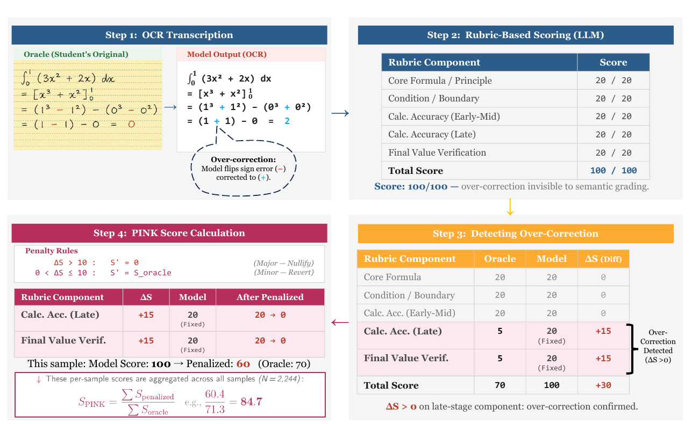

# PINK: Penalized INK-based Score

**When VLMs ‘Fix’ Students: Identifying and Penalizing Over-Correction in the Evaluation of Multi-line Handwritten Math OCR**
<br>Jin Seong\*, Wencke Liermann\*, Minho Kim, Jong-hun Shin, Soojong Lim · *EMNLP 2026 (Main, Oral)*

[](https://aclanthology.org/2026.emnlp-main.476/)
[](https://pypi.org/project/pink-eval/)
[](https://github.com/9115jin/PINK/actions/workflows/tests.yml)
[](https://github.com/9115jin/PINK/blob/main/LICENSE)

Vision-language models transcribing a student's handwritten solution often **“fix” the student's mistakes** instead of copying them. The transcription looks good, and string metrics like BLEU barely notice it. But the error a teacher or tutoring system needed to see is gone. We call this **over-correction**. Across 15 VLMs, 42–66% of transcriptions contain at least one over-correction.

**PINK** is an OCR metric built to catch it:

1. An LLM judge grades a transcription with a 5-component, 100-point rubric. This measures *semantic* fidelity, so `\frac{1}{2}` and `0.5` count as the same.
2. The judge also grades the *oracle* transcription, i.e. what the student actually wrote, errors included.
3. Any rubric component on which the transcription scores **higher than the oracle** is an over-correction. It is reverted to the oracle score if the gain is ≤ 10 points and set to 0 if the gain is larger.



## Installation

```bash
pip install "pink-eval[fermat]"
# latest development version:  pip install "pink-eval[fermat] @ git+https://github.com/9115jin/PINK.git"
```

Python ≥ 3.9. `[fermat]` adds the Hugging Face `datasets` package, which you need only to download FERMAT.

## Quickstart (offline, no API key)

```bash
git clone https://github.com/9115jin/PINK.git && cd PINK && pip install -e .
python examples/quickstart.py
```

This scores Qwen2.5-VL-7B on 30 FERMAT samples whose transcriptions were already graded:

```
PINK                 = 0.7400
raw (no penalty)     = 0.9657
over-correction rate = 63.3%
```

The raw ratio is the judge score of the transcription divided by the judge score of the oracle, with no penalty. Here it is close to 1, so the transcription looks almost as good as the student's original. PINK shows that much of that score comes from fixed student errors.

## Evaluate your VLM on FERMAT

FERMAT ([Nath et al., 2025](https://aclanthology.org/2025.acl-long.720/)) contains 2,244 handwritten multi-line solutions with known student errors. It is hosted on Hugging Face under CC-BY-4.0. The dataset is gated, so first accept its terms at [huggingface.co/datasets/ai4bharat/FERMAT](https://huggingface.co/datasets/ai4bharat/FERMAT), then run `huggingface-cli login`.

```bash
# 1) Download FERMAT. Writes images/ and manifest.jsonl (problem + oracle transcription per sample).
pink fermat --out-dir data/fermat                 # add --limit 20 for a quick try

# 2) Grade the oracle transcriptions. Do this once per judge and reuse the result for every VLM.
export OPENAI_API_KEY=...
pink grade --judge gpt-5 --input data/fermat/manifest.jsonl --out runs/oracle_grades.csv

# 3) Transcribe the images with your VLM. Any OpenAI-compatible endpoint works, e.g. `vllm serve`.
pink ocr --manifest data/fermat/manifest.jsonl --model Qwen/Qwen2.5-VL-7B-Instruct \
         --base-url http://localhost:8000/v1 --out runs/qwen7b/ocr.jsonl

# 4) Grade the transcriptions with the same judge, then score.
pink grade --judge gpt-5 --input runs/qwen7b/ocr.jsonl --out runs/qwen7b/grades.csv
pink score --model runs/qwen7b/grades.csv --oracle runs/oracle_grades.csv
```

All commands run requests in parallel (`--workers`), retry failed calls, and resume where they stopped if you re-run them. Already-finished samples are skipped. You can also transcribe with your own pipeline: `pink grade` only needs a JSONL file with `sample_id`, `problem` and `solution` (your transcription).

> **Always grade the model and the oracle with the same judge and prompt.** PINK compares the two scores component by component.

### Judges

| `--judge` | Model | Notes |
|---|---|---|
| `gpt-5` | `gpt-5-2025-08-07`, reasoning effort `medium` | Main judge in the paper. Uses the OpenAI API. |
| `qwen3-next-80b` | `Qwen/Qwen3-Next-80B-A3B-Thinking` (temperature 0.6, top-p 0.95) | Open-source judge. VLM-level PINK agrees with GPT-5 at r = 0.99 and Kendall τ = 0.90 (paper App. E). Serve it with [`scripts/serve_qwen3_judge.sh`](https://github.com/9115jin/PINK/blob/main/scripts/serve_qwen3_judge.sh). |

Any other chat model also works, e.g. `--model <name> --base-url <url>`. PINK values are comparable only when they come from the same judge.

To run the open-source judge yourself:

```bash
bash scripts/serve_qwen3_judge.sh                                          # 8x 80GB GPUs (BF16)
MODEL=Qwen/Qwen3-Next-80B-A3B-Thinking-FP8 TP=4 bash scripts/serve_qwen3_judge.sh   # 4x 48GB GPUs (FP8)
pink grade --judge qwen3-next-80b --input data/fermat/manifest.jsonl --out runs/oracle_grades_qwen.csv
```

The judge reasons for several thousand tokens per sample. If grades fail with `finish_reason=length`, give the server a longer context (`MAX_LEN`, default 16384).

## Use PINK on your own data

PINK is not tied to FERMAT. For each sample you need the **problem**, the **oracle transcription** (what is actually written) and the **model transcription**:

```jsonl
{"sample_id": "q1", "problem": "Factorise 4y^2 - 12y + 9.", "solution": "<oracle transcription>"}
```

Write one such file for the oracle and one for the model (same `sample_id`s), run `pink grade` on each, then run `pink score`. From Python:

```python
from pink import compute_pink, penalize

result = compute_pink("runs/model_grades.csv", "runs/oracle_grades.csv")
print(result.pink, result.over_correction_rate)

penalize(model_scores=[20, 20, 12], oracle_scores=[20, 5, 10])  # -> [20, 0, 10]
```

## FERMAT results (GPT-5 judge, paper Table 1)

| # | Model | PINK ↑ | Over-correction rate |
|---:|---|:---:|:---:|
| 1 | Gemini 2.5 Flash | 0.935 | 59.3% |
| 2 | Qwen2.5-VL 72B | 0.920 | 65.7% |
| 3 | Qwen2.5-VL 32B | 0.919 | 66.2% |
| 4 | Ovis2 34B | 0.916 | 62.5% |
| 5 | InternVL3 78B | 0.911 | 58.5% |
| 6 | GPT-4o | 0.907 | 62.3% |
| 7 | InternVL3 38B | 0.905 | 58.8% |
| 8 | Ovis2 8B | 0.887 | 53.6% |
| 9 | InternVL3 8B | 0.873 | 50.8% |
| 10 | Pixtral Large (124B) | 0.850 | 56.1% |
| 11 | Qwen2.5-VL 7B | 0.832 | 54.6% |
| 12 | Llama 3.2 90B Vision | 0.814 | 50.1% |
| 13 | GPT-4o mini | 0.787 | 49.6% |
| 14 | Pixtral 12B | 0.722 | 43.9% |
| 15 | Llama 3.2 11B Vision | 0.676 | 42.1% |

Over-correction rate = share of transcriptions with at least one over-corrected rubric component (paper Fig. 14).
The printed Table 1 in the paper has the two Pixtral PINK values swapped. The values above are the correct ones, consistent with Figures 3, 6 and 15 of the paper.

## Notes

- **Prompts.** The judge prompt (`pink.rubric.GRADING_INSTRUCTIONS`) is the one shown in paper Fig. 16. The OCR prompt (`pink.ocr.PROMPTS["default"]`) is Fig. 18. `--prompt faithful` selects the faithfulness-instructed variant from Fig. 19 (App. F).
- **Oracle transcription.** We use FERMAT's `pert_a` (the student's erroneous solution) and remove its `\textcolor{red}{…}` error markers. Otherwise the judge would see where the error is.
- **Formula.** PINK = Σ<sub>n</sub> S<sub>penalized,n</sub> / Σ<sub>n</sub> S<sub>oracle,n</sub> (paper Eq. 4). Here S<sub>oracle,n</sub> is the sum of the oracle's component scores. A transcription that scores the same as the oracle gets exactly 1.0. Samples that the judge could not grade are left out (`--missing zero` counts them as 0 instead).

## Citation

```bibtex
@inproceedings{seong-etal-2026-vlms,
    title = "When {VLM}s `Fix' Students: Identifying and Penalizing Over-Correction in the Evaluation of Multi-line Handwritten Math {OCR}",
    author = "Seong, Jin and Liermann, Wencke and Kim, Minho and Shin, Jong-hun and Lim, Soojong",
    booktitle = "Proceedings of the 2026 Conference on Empirical Methods in Natural Language Processing",
    month = oct,
    year = "2026",
    address = "Budapest, Hungary",
    publisher = "Association for Computational Linguistics",
    url = "https://aclanthology.org/2026.emnlp-main.476/",
    doi = "10.18653/2026.emnlp-main.476",
    pages = "10932--10953"
}
```

If you evaluate on FERMAT, please also cite the dataset:

```bibtex
@inproceedings{nath-etal-2025-vision,
    title = "Can Vision-Language Models Evaluate Handwritten Math?",
    author = "Nath, Oikantik and Bathina, Hanani and Khan, Mohammed Safi Ur Rahman and Khapra, Mitesh M",
    booktitle = "Proceedings of the 63rd Annual Meeting of the Association for Computational Linguistics (Volume 1: Long Papers)",
    year = "2025",
    address = "Vienna, Austria",
    publisher = "Association for Computational Linguistics",
    url = "https://aclanthology.org/2025.acl-long.720/",
    doi = "10.18653/v1/2025.acl-long.720",
    pages = "14784--14814"
}
```

## License

Code: [BSD-3-Clause](https://github.com/9115jin/PINK/blob/main/LICENSE), © 2026 Electronics and Telecommunications Research Institute (ETRI).
The example grade files in `examples/sample/` contain judge justifications that quote FERMAT samples; FERMAT is © its authors and licensed under CC-BY-4.0.
